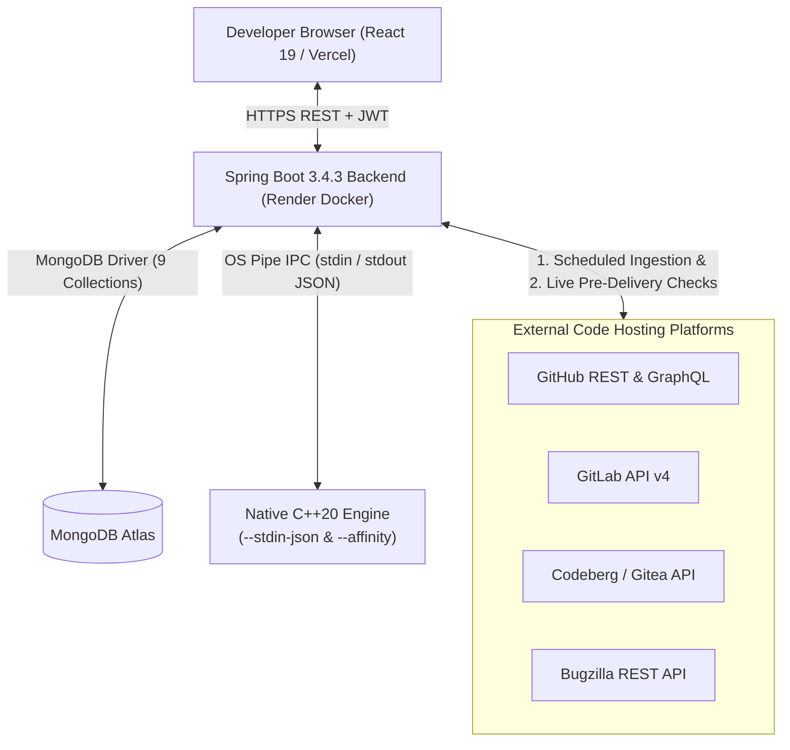

# Issue Pilot

> **A multi-platform open-source issue recommendation platform powered by Java 21 (Spring Boot), a native C++20 ranking engine, adaptive skill diagnostics, and live zero-assignment verification.**

[](https://issuepilot0.vercel.app)
[](https://issue-pilot-api.onrender.com/api/health)
[](src/test/java/com/issuepilot/)
[](https://adoptium.net/)
[](ranking_engine/)
[](LICENSE)

---

## Live Deployment

Issue Pilot is live in production and does not require local setup to use or evaluate:

* **Web Application (Vercel):** https://issuepilot0.vercel.app
* **Backend API Health Check (Render):** https://issue-pilot-api.onrender.com/api/health
* **Database:** MongoDB Atlas (`issue-pilot-staging`) storing **3,480+ ingested open-source issues** across 4 platforms.

---

## Table of Contents

1. [Problem Statement & Objectives](#1-problem-statement--objectives)
2. [Deployed System Architecture](#2-deployed-system-architecture)
3. [How Java and C++ Communicate (IPC)](#3-how-java-and-c-communicate-ipc)
4. [Working Features & Core Modules](#4-working-features--core-modules)
5. [The 6-Factor Ranking Formula](#5-the-6-factor-ranking-formula)
6. [Preference Learning Engine (Likes & Dislikes)](#6-preference-learning-engine-likes--dislikes)
7. [Database Design (MongoDB Atlas)](#7-database-design-mongodb-atlas)
8. [Verification & Test Results](#8-verification--test-results)
9. [REST API Endpoints](#9-rest-api-endpoints)
10. [Optional: Local Build & Reproducibility](#10-optional-local-build--reproducibility)

---

## 1. Problem Statement & Objectives

Finding a good open-source issue to work on is harder than it looks:
1. **Stale & Claimed Issues ("Ghost Issues"):** Static issue trackers often recommend tickets that were already assigned yesterday or already have an open Pull Request (`Fixes #123`), wasting hours of setup time.
2. **Subjective Difficulty Labels:** Tags like `good first issue` are manually added by maintainers and mean very different things across repositories.
3. **"Quiet GitHub" Bias:** Skilled developers who work primarily in private/company repositories (or students with few public repos) appear to have 0 experience when judged purely by public GitHub commit counts.
4. **Abandoned Repositories:** Many labeled issues belong to unmaintained repositories where PRs never get reviewed.

**Issue Pilot solves this by:**
* Verifying issue availability **live** against upstream APIs right before displaying recommendations.
* Separating **Developer Capability ($0–100$)** from **Objective Issue Difficulty ($0–100$)** using a deterministic C++ scoring model.
* Offering a **30-second Adaptive Flight Check** to measure skill directly instead of relying only on public GitHub stats.
* Continuously learning from user **Likes (👍)** and **Dislikes (👎)** in C++.

---

## 2. Deployed System Architecture

Issue Pilot runs as a decoupled three-tier cloud system:

| Layer | Technology Stack | Cloud Host | Responsibility |
| :--- | :--- | :--- | :--- |
| **Frontend UI** | React 19, TypeScript, TanStack Start, Vite v8, Tailwind CSS | **Vercel** | User authentication, onboarding calibration, recommendation feed, multi-platform explorer, tech profile. |
| **Orchestration Backend** | Java 21, Spring Boot 3.4.3, Maven | **Render** (Docker) | Multi-platform ingestion workers, live availability verification, JWT/OTP auth, REST API, C++ process management. |
| **Scoring & Affinity Engine** | C++20 (`g++`, CMake) | **Render** (bundled inside Docker container) | Deterministic 6-factor scoring (`--stdin-json`) and Laplace-smoothed vote affinity calculation (`--affinity`). |
| **Database** | MongoDB Atlas | **MongoDB Cloud** | Shared pool of 3,480+ issues, user profiles, encrypted OAuth tokens, OTPs, vote snapshots, recommendation logs. |



---

## 3. How Java and C++ Communicate (IPC)

Instead of JNI (Java Native Interface), Java invokes the compiled C++ binary as an isolated child process using **`java.lang.ProcessBuilder`** and **OS standard I/O pipes** ([`CppRankingClient.java`](src/main/java/com/issuepilot/service/CppRankingClient.java) $\leftrightarrow$ [`main.cpp`](ranking_engine/src/main.cpp)):

1. **Java $\to$ C++ (`stdin`):** Jackson serializes the user profile, factor weights, and matched issues into UTF-8 JSON and writes the bytes to `process.getOutputStream()`.
2. **C++ Processing:** `main.cpp` reads the JSON stream from `std::cin`, parses it into native C++ structs (`ContributorProfile`, `IssueRecord`, `RankingWeights`), executes the ranking or affinity math, and serializes results back to JSON.
3. **C++ $\to$ Java (`stdout`):** C++ prints the JSON output to `std::cout` and exits with code `0`. Java reads `process.getInputStream()` and parses it back into Java maps.

**Why Subprocess IPC over JNI?**
* **Crash Isolation:** A native memory error in C++ only terminates that single subprocess—it can never crash the Spring Boot server.
* **Timeout Guard:** Java enforces a strict 15-second timeout (`process.waitFor(15, SECONDS)`) and cleans up automatically.
* **Zero Memory Leaks:** Native allocations are reclaimed by the OS as soon as the subprocess exits.

---

## 4. Working Features & Core Modules

### A. Authentication & Resilient Email Verification (`/login`, `/auth/callback`)
* **GitHub OAuth 2.0:** One-click login that connects the contributor's GitHub identity and triggers automated repository skill analysis.
* **Local Email & Password Auth:** BCrypt password hashing (`local_credentials`), 6-digit HMAC-hashed OTP email verification (`email_otps`), rate-limited login protection, and OTP-backed password reset.
* **Resend API + Sandbox Auto-Fill:** Sends real OTP emails over HTTPS (Port 443) via Resend. When testing without a verified custom domain (`MAIL_SANDBOX_BYPASS=true`), the backend surfaces `sandbox_otp` securely so the login UI auto-fills the 6-digit code and notifies the user via toast—preventing `502 Bad Gateway` errors on cloud hosts like Render (which block outbound SMTP ports 25/465/587).

### B. Dual-Mode Smart Onboarding (`/onboarding`)
Users can calibrate their profile using either or both paths:
1. **30-Second Adaptive Flight Check (CAT Diagnostic):**
   * A 2-question scenario-based quiz across 8 domains (`Python`, `TypeScript`, `React`, `Go`, `Java`, `C++`, `Docker`, `OSS_Workflow`).
   * Starts at an **Intermediate ($65$)** scenario; answering optimally steps up to **Advanced ($85$)**, while missing it steps down to **Beginner ($35$)**.
   * Solves "Quiet GitHub" bias by giving developers with 0 public repos a verified capability rating ($0.90$ confidence) immediately, or blending $60\%$ diagnostic score + $40\%$ GitHub score when public repos exist.
   * Supports dynamic scenario generation via **Google Gemini 1.5 Flash** (`GEMINI_API_KEY`) with instant zero-latency fallback to the built-in rubric corpus.
2. **GitHub Stack Scanner & 3-Step Calibration Deck:**
   * Scans public GitHub repositories, languages, and commit/PR metrics (`GitHubProfileAnalyzerService`) to infer initial skill scores.
   * Allows manual adjustment of experience level, codebase comfort, challenge goal, and confirmed tech stack.

### C. Personalized Recommendations Feed (`/app/feed` & `/app/recommendations/$id`)
1. **Stack-Matched Batching:** `TechnologyMatchingService` queries MongoDB Atlas for **up to 100** open, unassigned issues matching the user's confirmed/inferred technologies (balanced across GitHub 50%, Bugzilla 20%, GitLab 15%, Codeberg 15%).
2. **Authoritative C++ Scoring:** All matched candidates are scored and sorted deterministically by the C++20 engine.
3. **Live Pre-Delivery Verification (`LiveVerifier.java`):** Before showing recommendations, the backend polls live platform APIs on the top-ranked issues to confirm they are still open, unassigned, and have no open linked Pull Requests. If a top issue was recently claimed, it is deleted from Atlas and automatically replaced by the next highest-ranked issue (capped at a max check ceiling of `30` issues per request to protect API rate limits).
4. **Diversity & Rotation:** Ensures different repositories appear near the top and rotates unseen issues ahead of previously viewed ones.

### D. Multi-Platform Issue Explorer (`/app/explore`)
* Browse, search, and filter all **3,480+ vetted issues** across **GitHub, GitLab, Codeberg, and Bugzilla**.
* Aligned difficulty filtering synced between MongoDB queries and UI badges:
  * **Beginner:** Technical Complexity $< 45$
  * **Intermediate:** Technical Complexity $45 \le x < 70$
  * **Advanced:** Technical Complexity $\ge 70$

### E. Contributor Tech Profile (`/app/profile`)
* Displays calibrated capability score ($0–100$), confidence percentage, confirmed skills, GitHub-inferred skills, and direct links to recalibrate.

---

## 5. The 6-Factor Ranking Formula

Computed natively in `ranking_engine/src/ranking_engine.cpp` on a normalized $0–100$ scale:

$$\text{FinalScore} = 0.35S + 0.25D + 0.15R + 0.10H + 0.10F + 0.05N$$

| Factor | Weight | Description |
| :--- | :---: | :--- |
| **$S$ — Skill Match** | **35%** | Weighted overlap between contributor skills and the issue's detected stack (enforces a $\ge 50\%$ stack coverage gate). |
| **$D$ — Difficulty Match** | **25%** | Asymmetric distance between Contributor Capability ($C$) and Issue Complexity ($D_{\text{obj}}$). Over-hard issues incur a **$1.5\times$ burnout penalty** vs. $1.0\times$ for easier ones. |
| **$R$ — Maintainer Responsiveness** | **15%** | Median first response hours, 90-day issue response rate, PR review turnaround, and recent maintainer activity. |
| **$H$ — Repository Health** | **10%** | 90-day commit velocity, 30-day PR merge rate, active contributor count, and maintainer presence. |
| **$F$ — Feedback / History** | **10%** | Contributor acceptance rate, completion rate, and similarity to previously completed issues. |
| **$N$ — Freshness** | **5%** | Time-decay score from issue creation (60-day half-life) and last non-bot activity (14-day half-life). |

**Missing-Data Renormalization:** When a metric is unavailable (for example, a brand-new user with no feedback history), it is never penalized as `0`; its weight is redistributed proportionally across the available factors so effective weights always sum to `1.0`.

---

## 6. Preference Learning Engine (Likes & Dislikes)

On any issue card, contributors can cast **Like (👍)** or **Dislike (👎)** votes with specific dislike reasons:
* `Not my tech stack`
* `Too complex` *(nudges capability down)*
* `Too simple` *(nudges capability up)*
* `Unclear description`
* `Don't show this repo` *(blacklists repository for the user)*

Votes store an immutable `feature_snapshot` in `issue_votes`. On future recommendation runs, `VoteAffinityService` runs the C++ `--affinity` engine (`ranking_engine/src/vote_affinity.cpp`), comparing new candidates across 6 weighted dimensions (technologies 30%, labels 30%, issue type 15%, difficulty proximity 10%, domain 10%, repo 5%), damping repeated near-identical votes ($\text{sim} \ge 0.85$), and computing a Laplace-smoothed ($\lambda = 1.0$) affinity score in $[-100, +100]$ with plain-English explanations.

---

## 7. Database Design (MongoDB Atlas)

The backend manages **9 MongoDB collections** with startup index verification (and in-memory fallbacks if Atlas is unreachable):

1. **`issues`**: Shared multi-platform issue pool (`source`, `repository_full_name`, `issue_number`, `detected_technologies`, `difficulty_evidence`, `responsiveness_evidence`, `health_evidence`, `freshness_evidence`).
2. **`users`**: Contributor profiles, capability ($C$), confidence, confirmed/inferred skills, onboarding flags.
3. **`issue_votes`**: User 👍/👎 votes, dislike reasons, and `feature_snapshot` records.
4. **`recommendations`**: Audit snapshots of ranked runs and delivered cards.
5. **`feedback`**: Historical accept / reject / complete outcome logs.
6. **`jobs`**: Ingestion discovery and refresh job execution history.
7. **`local_credentials`**: Isolated BCrypt password hashes and email verification status.
8. **`email_otps`**: HMAC-hashed 6-digit OTPs with automatic TTL expiration on `expires_at`.
9. **`user_tokens`**: Encrypted GitHub OAuth access tokens and short-lived auth exchange codes.

---

## 8. Verification & Test Results

* **Spring Boot Automated Suite (`mvn test`):** **225 / 225 tests passing** (unit & integration tests covering ranking, vote affinity, adaptive diagnostics, local OTP auth, multi-platform adapters, and MongoDB compatibility).
* **C++20 Engine Tests (`ctest`):** Passing unit suites (`test_ranking` and `test_affinity`) compiled and verified automatically inside the production Docker build.
* **Frontend Production Build (`npm run build`):** Zero TypeScript/Vite build errors (deployed on Vercel).

---

## 9. REST API Endpoints

| Domain | Endpoints |
| :--- | :--- |
| **Health** | `GET /api/health` |
| **Authentication** | `GET /api/auth/github/login`, `GET /api/auth/github/callback`, `POST /api/auth/exchange`, `POST /api/auth/register`, `POST /api/auth/verify-otp`, `POST /api/auth/resend-otp`, `POST /api/auth/login`, `POST /api/auth/forgot-password`, `POST /api/auth/reset-password`, `GET /api/auth/me`, `POST /api/auth/logout` |
| **Profile & Onboarding** | `GET /api/profile/me`, `GET /api/profile/onboarding`, `POST /api/profile/onboarding/confirm`, `POST /api/profile/analyze`, `PUT /api/profile/skills/{technology}`, `DELETE /api/profile/skills/{technology}`, `PUT /api/profile/preferences` |
| **Adaptive Diagnostic** | `GET /api/onboarding/diagnostic/domains`, `POST /api/onboarding/diagnostic/start`, `POST /api/onboarding/diagnostic/step` |
| **Recommendations** | `POST /api/recommendations/personalized`, `GET /api/recommendations/{id}`, `GET /api/recommendations/snapshots/{userId}`, `GET /api/recommendations/runs/{runId}` |
| **Issues Explorer** | `GET /api/issues`, `GET /api/issues/{issueId}`, `POST /api/issues/batch-upsert` |
| **Votes & Affinity** | `POST /api/votes`, `DELETE /api/votes`, `GET /api/votes/{userId}`, `GET /api/votes/summary/{userId}`, `POST /api/votes/affinity` |
| **Ingestion** | `POST /api/ingestion/run`, `POST /api/ingestion/discover`, `POST /api/ingestion/refresh`, `POST /api/ingestion/cleanup`, `GET /api/ingestion/status`, `GET /api/ingestion/jobs` |
| **Evaluation** | `POST /api/validation/run`, `GET /api/validation/evaluation-report` |

---

## 10. Optional: Local Build & Reproducibility

Since the system is already live on **Vercel** and **Render**, end users and reviewers do not need to install or compile anything locally. For developers or project evaluators who want to reproduce the build from source:

<details>
<summary>Expand Local Build, Test & Docker Reference</summary>

### 1. C++20 Ranking Engine
```bash
cmake -B ranking_engine/build -S ranking_engine
cmake --build ranking_engine/build
ctest --test-dir ranking_engine/build --output-on-failure
```

### 2. Spring Boot Backend (Java 21)
```bash
mvn test              # Runs all 225 backend tests
mvn spring-boot:run   # Starts API at http://localhost:8000
```

### 3. Frontend (React + Vite)
```bash
cd frontend
npm install
npm run dev           # Starts dev server at http://localhost:5173
```

### 4. Production Multi-Stage Docker Image
The [`Dockerfile`](Dockerfile) builds the Linux C++20 binary (`ubuntu:24.04`), runs CTest, builds the Spring Boot JAR (`maven:3.9.9-eclipse-temurin-21`), and outputs a minimal JRE 21 image exposing port `8000`.

### 5. Key Environment Variables
* **Core:** `PORT`, `MONGODB_URI`, `APP_JWT_SECRET`, `APP_ENCRYPTION_KEY`, `CPP_ENGINE_PATH`
* **Platforms:** `GITHUB_CLIENT_ID`, `GITHUB_CLIENT_SECRET`, `GITHUB_TOKEN`, `GITLAB_TOKEN`
* **AI & Email:** `GEMINI_API_KEY`, `RESEND_API_KEY`, `MAIL_FROM`, `MAIL_SANDBOX_BYPASS=true`

</details>

---

## License

Licensed under the [Apache License, Version 2.0](LICENSE).
