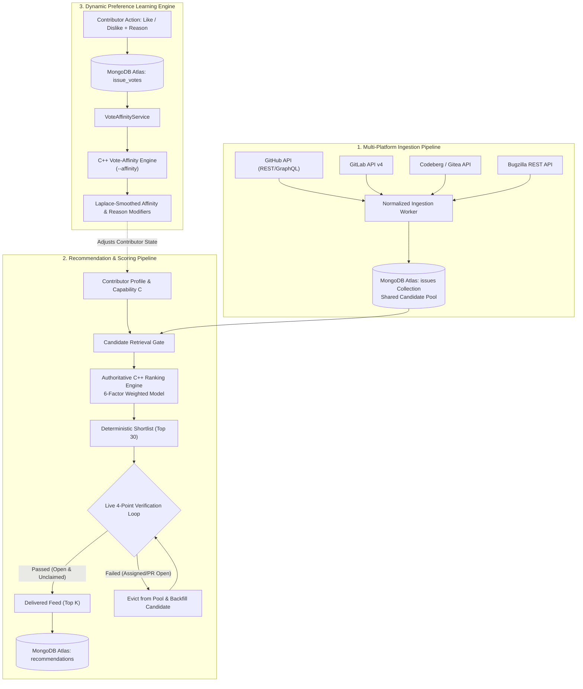

# Issue Pilot

> **Deterministic, explainable open-source issue recommendation, multi-platform verification, and dynamic preference learning.**

Issue Pilot solves the open-source contributor onboarding bottleneck. Traditional issue labels (`good first issue`, `help wanted`) are often stale, over-subscribed, or subjective. An issue considered "easy" by an experienced systems programmer can be insurmountable for a beginner, while trivial issues bore senior engineers. Furthermore, many recommended issues are already claimed by an open pull request or assigned to another contributor, wasting developer time.

Issue Pilot combines an authoritative **6-factor C++14/20 ranking engine**, continuous **live zero-assignment re-verification** across 4 major code-hosting platforms (GitHub, GitLab, Codeberg, and Bugzilla), and an **independent C++ preference-learning engine** that adapts to contributor likes, dislikes, and specific feedback reasons without sacrificing mathematical determinism.

---

## Table of Contents

1. [System Architecture & Data Flow](#1-system-architecture--data-flow)
2. [Why Live Backend & Zero-Assignment Verification?](#2-why-live-backend--zero-assignment-verification)
3. [The 6-Factor Authoritative Ranking Model](#3-the-6-factor-authoritative-ranking-model)
   - [Factor 1: Skill Match ($S$) & Multi-Technology Stacks](#factor-1-skill-match-s--multi-technology-stacks)
   - [Factor 2: Difficulty Match ($D$) — Subjective vs. Objective Fit](#factor-2-difficulty-match-d--subjective-vs-objective-fit)
   - [Factor 3: Maintainer Responsiveness ($R$)](#factor-3-maintainer-responsiveness-r)
   - [Factor 4: Repository Health ($H$)](#factor-4-repository-health-h)
   - [Factor 5: Feedback / History ($F$)](#factor-5-feedback--history-f)
   - [Factor 6: Freshness ($N$)](#factor-6-freshness-n)
   - [Dynamic Missing-Data Renormalization](#dynamic-missing-data-renormalization)
4. [Dynamic Preference Learning Engine](#4-dynamic-preference-learning-engine)
   - [Lifecycle of a Vote: Likes, Dislikes, and Reason Modifiers](#lifecycle-of-a-vote-likes-dislikes-and-reason-modifiers)
   - [Deterministic Adaptation: How Past Votes Shape Future Rankings](#deterministic-adaptation-how-past-votes-shape-future-rankings)
   - [Pairwise Similarity, Damping, and Laplace Evidence](#pairwise-similarity-damping-and-laplace-evidence)
5. [What-If Algorithm Simulator](#5-what-if-algorithm-simulator)
6. [Multi-Platform Ingestion & 4-Point Health Verification](#6-multi-platform-ingestion--4-point-health-verification)
7. [Database Architecture & MongoDB Atlas Schemas](#7-database-architecture--mongodb-atlas-schemas)
8. [REST API Reference](#8-rest-api-reference)
9. [Build, Test, and Operational Commands](#9-build-test-and-operational-commands)

---

## 1. System Architecture & Data Flow

Issue Pilot consists of three decoupled layers:
1. **Spring Boot 3.4.3 Backend (Java 21)**: Coordinates multi-platform ingestion, orchestrates live verification loops, manages token-based authentication and rate limits, and interfaces with MongoDB Atlas.
2. **Authoritative C++14/20 Ranking & Vote-Affinity Core**: Performs deterministic 6-factor candidate scoring and Laplace-smoothed preference learning in sub-millisecond IPC runs (`--stdin-json` and `--affinity`).
3. **TanStack Start / React 19 Frontend**: Responsive desktop and mobile interface with zero-dependency tactile components, live capability calibrations, and hardware-fader algorithmic simulators.



---

## 2. Why Live Backend & Zero-Assignment Verification?

Open-source issue aggregators frequently fail because they treat GitHub and GitLab like static catalogs. Real-world repositories have two critical failure modes:

1. **The "Ghost Issue" Collision**: A beginner searches for an issue, spends three hours setting up the environment and writing a fix, only to open a PR and discover that another contributor was assigned the issue two days earlier, or an unmerged PR (`Fixes #102`) was already under review.
2. **The "Abandoned Repo" Black Hole**: An issue has the label `good-first-issue`, but the maintainers have not pushed a commit or reviewed a PR in eighteen months. Any PR submitted will sit indefinitely without attention.

### The 4-Point Health Check Protocol
Before any issue is surfaced in a user's feed, Issue Pilot executes a live, real-time 4-point verification check against the upstream platform:

1. **Issue State**: Must be strictly `open`. Closed, locked, or completed issues are immediately purged.
2. **Zero Assignees**: `assignee_id == null` and `assignees.length == 0`. If any developer has claimed the issue, it is disqualified.
3. **Zero Active Pull Requests**: The platform timeline and cross-references are inspected to verify that no open PR contains linking keywords (`fixes #N`, `closes #N`, `resolves #N`) targeting the issue.
4. **Active Maintainer Pulse**: The repository must not be archived or disabled, and maintainer commits or triage actions must have occurred within the last 90 days.

### Deterministic Backfill Loop
When a user requests $K$ recommendations (e.g., $K = 5$), the C++ ranking engine evaluates the candidate pool and produces a deterministic shortlist of $N = 30$ issues. The backend verifies candidates in rank order:
- If Candidate #1 passes all 4 checks, it is added to the delivery set.
- If Candidate #2 has a pull request opened 10 minutes ago, it is flagged as claimed in Atlas, evicted from the pool, and Candidate #31 is fetched to maintain a full evaluation set.
- The loop continues until exactly $K$ guaranteed open, unassigned issues are verified and returned.

---

## 3. The 6-Factor Authoritative Ranking Model

Final suitability scores are computed on a normalized scale of $0 - 100$:

$$\text{FinalScore} = 0.35S + 0.25D + 0.15R + 0.10H + 0.10F + 0.05N$$

| Factor | Name | Weight | Primary Measurement Objective |
| :---: | :--- | :---: | :--- |
| **$S$** | **Skill Match** | **35%** | Alignment between contributor tech proficiency and the issue's full technology stack. |
| **$D$** | **Difficulty Match** | **25%** | Asymmetric proximity between Contributor Capability ($C$) and Objective Issue Difficulty ($D_{\text{obj}}$). |
| **$R$** | **Maintainer Responsiveness** | **15%** | Probability that submitted pull requests and questions will receive timely maintainer reviews. |
| **$H$** | **Repository Health** | **10%** | Vitality, release cadence, and contributor community health over sliding 90-day windows. |
| **$F$** | **Feedback / History** | **10%** | Contributor-specific historical completion rates and similarity to past successful contributions. |
| **$N$** | **Freshness** | **5%** | Recency of issue creation and maintainer activity (mitigating abandoned/stale tasks). |

---

### Factor 1: Skill Match ($S$) & Multi-Technology Stacks

#### The Multi-Stack Problem
Open-source issues rarely involve a single programming language. An issue might involve Python backend logic, but also require PyTorch tensor manipulation and Docker container configuration. If a contributor has 74% proficiency in Python but has never used PyTorch or Docker, recommending this issue with a "100% Skill Match" leads to immediate failure.

#### Mathematical Specification
Each issue has a set of detected technologies $T = \{t_1, t_2, \dots, t_m\}$ with raw relevance scores $r(I, t_i) > 0$. The normalized relevance of each technology is:

$$w_{t_i} = \frac{r(I, t_i)}{\sum_{j=1}^m r(I, t_j)}$$

The contributor profile contains demonstrated skill ratings $s(u, t) \in [0, 100]$ and confidence metrics $c(u, t) \in [0, 1]$ across known technologies.

1. **Stack Coverage Gate ($A_{\text{cov}}$)**:
   $$A_{\text{cov}} = \sum_{t \in T \cap \text{Profile}} w_t$$
   If $A_{\text{cov}} < 0.50$, the issue **fails the coverage gate** ($S = 0$, marked as unavailable). The system will never recommend an issue where the contributor is unfamiliar with more than half of the required stack.

2. **Weighted Skill Score ($S$)**:
   $$S = \frac{\sum_{t \in T \cap \text{Profile}} w_t \cdot s(u, t)}{A_{\text{cov}}}$$

3. **Uncovered Stack Penalty**:
   Even if an issue passes the 50% coverage gate, any uncovered secondary technologies directly reduce the skill confidence:
   $$\text{Confidence}_S = \sum_{t \in T \cap \text{Profile}} w_t \cdot c(u, t)$$
   This ensures that an issue requiring `[Python 70%, PyTorch 20%, Docker 10%]` yields a lower confidence and rank for a Python-only developer than an issue requiring 100% Python.

---

### Factor 2: Difficulty Match ($D$) — Subjective vs. Objective Fit

#### The Core Subjective Paradox
Difficulty is fundamentally subjective. A concurrency bug in a C++ memory pool is trivial for a senior systems engineer, but impossible for a junior developer. Conversely, fixing a typo in markdown documentation is easy for everyone, but senior developers consider it unrewarding.

Issue Pilot solves this by decoupling **Contributor Capability ($C$)** from **Objective Issue Difficulty ($D_{\text{obj}}$)** and evaluating their **asymmetric fit distance**.

#### Step A: Contributor Capability Calibration ($C \in [0, 100]$)
Contributor capability is derived through a dual-channel Bayesian calibration:

1. **Behavioral Calibration Questionnaire**:
   - **$Q_1$ Experience Level**: Beginner ($25$), Intermediate ($55$), Advanced ($80$), Staff/Principal ($95$).
   - **$Q_2$ Codebase Comfort**: Documentation & Tests ($20$), Small Modules ($50$), Large Monorepos ($85$), Compilers & Kernels ($95$).
   - **$Q_3$ Challenge Appetite**: Easy warm-up ($-10$ offset), Standard feature/bugfix ($+0$), Core architectural challenge ($+15$ boost).
   - This produces the subjective baseline $C_{\text{survey}} \in [0, 100]$.

2. **Verified Git Activity (Objective Evidence)**:
   When GitHub integration is active, code history is analyzed across four dimensions:
   - **Repository Diversity**: $S_{\text{repo}} = 100 \cdot (1 - e^{-N_{\text{repos}} / 3.0})$
   - **Pull Request Volume**: $S_{\text{PR}} = 100 \cdot (1 - e^{-N_{\text{PRs}} / 5.0})$
   - **Merge Rate**: $M = \frac{N_{\text{merged}}}{N_{\text{decided}}} \times 100$
   - **Recency Decay**: Half-life decay over 12 months: $R_{\text{act}} = 100 \cdot (0.5)^{\Delta t / 12.0}$
   - Blended into an objective capability score $C_{\text{git}}$ with evidence confidence $c_{\text{git}} \in [0, 1]$.

3. **Bayesian Capability Fusion**:
   $$C = c_{\text{git}} \cdot C_{\text{git}} + (1 - c_{\text{git}}) \cdot C_{\text{survey}}$$

#### Step B: Objective Issue Difficulty ($D_{\text{obj}} \in [0, 100]$)
Objective difficulty is evaluated across 4 structural architectural signals anchored to discrete ordinal tiers $\{0, 25, 50, 75, 100\}$:
- **Scope Change Size ($SC$, 30%)**: Estimated files, functions, and lines touched.
- **Technical Complexity ($TC$, 30%)**: Algorithmic depth, concurrency, state machines, and internals.
- **Dependency & Architectural Impact ($DI$, 20%)**: Public API contracts, breaking schema changes, IPC boundaries.
- **Coordination Complexity ($CC$, 20%)**: Multi-maintainer review requirements, RFC consensus, cross-team approvals.

Coverage requirement: At least 50% of signals must be available ($A_{ID} \ge 0.50$):
$$D_{\text{raw}} = \frac{0.30 \cdot SC + 0.30 \cdot TC + 0.20 \cdot DI + 0.20 \cdot CC}{A_{ID}}$$

**Label Corroboration**: Clamped adjustment $\Delta_{\text{label}} \in [-3.0, +3.0]$ based on verified taxonomy labels:
- `good-first-issue`, `easy`, `beginner`, `starter` $\implies -1.5$ per label
- `hard`, `complex`, `advanced`, `expert`, `high-complexity` $\implies +1.5$ per label

$$D_{\text{obj}} = \max\left(0.0, \min\left(100.0, D_{\text{raw}} + \Delta_{\text{label}}\right)\right)$$

#### Step C: Asymmetric Fit Penalty
Let the fit gap be $g = D_{\text{obj}} - C$.

$$\text{Penalty} = \begin{cases} 
0 & \text{if } |g| \le 5 \quad \text{(Sweet spot: issue difficulty matches user capability)} \\
1.5 \cdot (g - 5) & \text{if } g > 5 \quad \text{(Issue too hard — 1.5x burnout penalty)} \\
1.0 \cdot (|g| - 5) & \text{if } g < -5 \quad \text{(Issue too easy — 1.0x boredom penalty)}
\end{cases}$$

$$D = \max(0.0, \min(100.0, 100.0 - \text{Penalty}))$$

> **Why the 1.5x Asymmetry?** Recommending an issue that is too difficult leads to contributor fatigue, abandoned branches, and frustration. Recommending an issue that is slightly too easy is still solvable. Therefore, over-difficulty is penalized 50% more aggressively than under-difficulty.

---

### Factor 3: Maintainer Responsiveness ($R$)

Maintainer responsiveness measures whether a submitted PR will actually be reviewed. It combines four signals:

$$R = 0.30 \cdot RT + 0.30 \cdot RR + 0.25 \cdot PR + 0.15 \cdot MA$$

1. **Median First Response Time ($RT$, 30%)**:
   - $< 4$ hours $\to 100$
   - $4 - 24$ hours $\to 85$
   - $1 - 3$ days $\to 65$
   - $3 - 7$ days $\to 40$
   - $> 7$ days $\to 10$
2. **Issue Response Rate ($RR$, 30%)**: Percentage of issues opened in the last 90 days that received at least one non-bot maintainer comment.
3. **PR Review Turnaround ($PR$, 25%)**: Median time from pull request creation to initial maintainer code review.
4. **Recent Maintainer Activity ($MA$, 15%)**: Recency score based on days since the last maintainer commit or review action.

---

### Factor 4: Repository Health ($H$)

Repository health ensures that the underlying project is active, stable, and sustainable. It evaluates 4 components over a 90-day sliding window:

$$H = \frac{0.30 \cdot C_{90} + 0.25 \cdot PR_{30} + 0.25 \cdot AU_{90} + 0.20 \cdot MA_{90}}{\sum \text{available weights}}$$

- **$C_{90}$ (30%)**: Commit frequency over the last 90 days (saturated at 50 commits).
- **$PR_{30}$ (25%)**: Pull request merge/closure rate over the last 30 days.
- **$AU_{90}$ (25%)**: Unique active contributors contributing commits in the last 90 days (community breadth).
- **$MA_{90}$ (20%)**: Core maintainer presence and triage frequency.

---

### Factor 5: Feedback / History ($F$)

Measures a contributor's historical performance on issues recommended by Issue Pilot:

$$F = 0.30 \cdot A + 0.40 \cdot C_{\text{comp}} + 0.30 \cdot S_{\text{hist}}$$

- **Acceptance Rate ($A$, 30%)**: $\frac{N_{\text{accepted}}}{N_{\text{accepted}} + N_{\text{rejected}}} \times 100$
- **Completion Rate ($C_{\text{comp}}$, 40%)**: $\frac{N_{\text{completed}}}{N_{\text{accepted}}} \times 100$
- **Historical Similarity ($S_{\text{hist}}$, 30%)**: Feature similarity between the candidate issue and tasks the contributor previously completed successfully.

**Cold-Start Policy**: If a contributor is new and has no contribution history, $F$ is flagged as unavailable and renormalized out of the calculation.

---

### Factor 6: Freshness ($N$)

Freshness prevents the recommendation of stale or abandoned issues:

$$N = 0.40 \cdot \text{Score}_{\text{age}} + 0.60 \cdot \text{Score}_{\text{act}}$$

- **Age Score**: Exponential decay from creation date:
  $$\text{Score}_{\text{age}} = 100 \cdot e^{-\Delta t_{\text{age}} / 60.0}$$
  (60-day half-life).
- **Activity Score**: Exponential decay from the most recent non-bot comment or label triage:
  $$\text{Score}_{\text{act}} = 100 \cdot e^{-\Delta t_{\text{idle}} / 14.0}$$
  (14-day half-life).

---

### Dynamic Missing-Data Renormalization

When any component is unavailable (e.g., maintainer response metrics are rate-limited, or a new user has no feedback history), **Issue Pilot never treats missing data as 0**. A missing factor is omitted, and the weights of available factors are scaled proportionally to sum to 1.0:

$$W_{\text{avail}} = \sum_{j \in \text{Available}} w_j$$

$$\text{EffectiveWeight}_i = \frac{w_i}{W_{\text{avail}}}$$

$$\text{FinalScore} = \sum_{i \in \text{Available}} \left(\text{Score}_i \cdot \text{EffectiveWeight}_i\right)$$

---

## 4. Dynamic Preference Learning Engine

### Lifecycle of a Vote: Likes, Dislikes, and Reason Modifiers

Contributors can provide immediate feedback on any recommended issue using the tactile Like (👍) and Dislike (👎) actions.

When a user clicks **Dislike (👎)**, a 1-click modal captures the exact operational reason:
1. `Not my tech stack`: The developer does not want issues involving this language, framework, or dependency.
2. `Too complex`: The issue exceeds the developer's current comfort level.
3. `Too simple`: The issue is trivial (e.g., fixing a typo) and unchallenging.
4. `Unclear description`: The issue lacks reproduction steps, specifications, or context.
5. `Don't show this repo`: The developer wishes to blacklist the entire repository.

```
[User Clicks 👎]
       │
       ▼
[Select Reason Modal]
  ├── "Not my tech stack"     ──> Suppresses language/framework weight
  ├── "Too complex"           ──> Nudges Capability Dial down (ΔC = -5)
  ├── "Too simple"            ──> Nudges Capability Dial up (ΔC = +5)
  ├── "Unclear description"   ──> Flags candidate quality score in Atlas
  └── "Don't show this repo"  ──> Inserts repository into user blacklist
       │
       ▼
[Store in MongoDB Atlas (issue_votes)]
       │
       ▼
[Next Recommendation Run] ──> C++ --affinity Engine Applies Laplace Smoothing
```

---

### Deterministic Adaptation: How Past Votes Shape Future Rankings

A common architectural question is: **"If our ranking engine is deterministic C++, how can a changing variable like a vote alter future recommendations?"**

The answer lies in **pure functional state separation**:
1. The C++ ranking engine is a deterministic function: $f(\text{Candidate}, \text{UserProfile})$. It has no hidden state or random number generators.
2. When a user casts a vote or selects a dislike reason, it updates the `UserProfile` and records an immutable `feature_snapshot` in the `issue_votes` collection.
3. On the next recommendation run, the updated profile and past vote snapshots are passed into the C++ engine.
4. Because the input vector changed, the deterministic engine produces an updated, personalized ranking order.

---

### Pairwise Similarity, Damping, and Laplace Evidence

The C++ `--affinity` engine measures how closely a candidate issue matches a user's liked and disliked history:

#### 1. Feature Snapshot Comparison
Similarity between candidate issue $c$ and voted issue $v$ is computed across 6 weighted groups:
- **Technologies ($30\%$)**: Jaccard similarity $J(T_c, T_v) = \frac{|T_c \cap T_v|}{|T_c \cup T_v|}$
- **Labels ($30\%$)**: Jaccard similarity across normalized tags $J(L_c, L_v)$
- **Issue Type ($15\%$)**: Categorical match (`bug`, `feature`, `doc`, `refactor`)
- **Difficulty Proximity ($10\%$)**: $1.0 - \frac{|D_c - D_v|}{100.0}$
- **Domain Metadata ($10\%$)**: Product/subsystem token overlap
- **Repository Path ($5\%$)**: Exact canonical path match

#### 2. Correlated Vote Damping
If a user casts 10 dislikes on 10 issues from the exact same repository with identical tags, treating each vote independently would artificially inflate negative evidence tenfold.

The engine applies pairwise correlation damping among like-signed votes with similarity $\ge 0.85$:
$$\text{effective\_weight}_i = \frac{1.0}{1.0 + \sum_{j < i, \, \text{sim}(v_i, v_j) \ge 0.85} \text{sim}(v_i, v_j)}$$

#### 3. Laplace-Smoothed Evidence Accumulation
For each candidate $c$, positive evidence $P$ and negative evidence $N$ are accumulated:
$$P = \sum_{v \in \text{Likes}} \text{effective\_weight}_v \cdot \text{similarity}(c, v)$$
$$N = \sum_{v \in \text{Dislikes}} \text{effective\_weight}_v \cdot \text{similarity}(c, v)$$

The signed affinity score $[-100, +100]$ is computed with Laplace smoothing ($\lambda = 1.0$):
$$\text{AffinityScore} = 100 \times \frac{P - N}{P + N + \lambda}$$

- **Confidence Metric**: $C_{\text{aff}} = \frac{P + N}{P + N + 3.0} \in [0, 1]$
- **Conflict Indicator**: If both $P$ and $N$ are large and $\frac{2 \cdot \min(P, N)}{P + N} \ge 0.40$, a conflict flag is raised, signaling that the user has conflicting preferences for this issue type.

---

## 5. What-If Algorithm Simulator

### Why Does the Simulator Exist?
Most recommendation algorithms operate as opaque "black boxes." Developers have no way of knowing why an issue was selected or how to adjust the results to fit their goals.

The **What-If Algorithm Simulator** provides complete algorithmic transparency:
- **Hardware-Fader Sliders**: Contributors can adjust factor weights in real time (e.g., increase Responsiveness to 50% if they need rapid feedback, or increase Difficulty to 60% if they want a steep challenge).
- **Capability Dial Simulation**: Developers can drag their simulated capability score ($0 - 100$) and immediately watch the C++ engine re-rank issues with smooth layout-swap animations.
- **Sensitivity Analysis**: Reveals exactly how sensitive a recommendation is to changes in maintainer velocity or repository activity.

---

## 6. Multi-Platform Ingestion & 4-Point Health Verification

Issue Pilot supports 4 major code-hosting platforms through unified adapter contracts:

| Platform | Ingestion Strategy | Claim Verification Mechanism | Rate Limit Policy |
| :--- | :--- | :--- | :--- |
| **GitHub** | REST Search API & GraphQL timeline queries | Inspects `assignees[]` and issue event timeline for cross-referenced PRs. | Authenticated PAT (5,000 req/hr) with exponential backoff. |
| **GitLab** | GitLab API v4 projects & issues endpoint | Verifies `assignee_id == null` and checks linked merge requests via issue links API. | Personal Access Token with per-minute sliding window throttling. |
| **Codeberg** | Gitea REST API v1 | Queries open issues with zero assignees on public privacy-respecting FOSS repositories. | Respects `X-RateLimit` headers; 60 req/min fallback. |
| **Bugzilla** | Bugzilla REST API (`/rest/bug`) | Evaluates `assigned_to` against default nobody accounts (`nobody@mozilla.org`), checking whiteboard tags. | Controlled batch queries (max 50 per batch). |

---

## 7. Database Architecture & MongoDB Atlas Schemas

The Spring Boot backend manages 6 MongoDB collections with automatic startup index verification:

### 1. `issues` (Candidate Pool)
```json
{
  "_id": "github_pallets_flask_5120",
  "source": "github",
  "repository_full_name": "pallets/flask",
  "issue_number": 5120,
  "title": "Fix context leak in Blueprint tear-down handlers",
  "issue_url": "https://github.com/pallets/flask/issues/5120",
  "state": "open",
  "is_assigned": false,
  "detected_technologies": ["Python", "Flask"],
  "difficulty_evidence": {
    "scope_change_size": 25.0,
    "technical_complexity": 50.0,
    "dependency_arch_impact": 25.0,
    "coordination_complexity": 25.0
  },
  "responsiveness_evidence": {
    "median_first_response_hours": 3.2,
    "response_rate_percent": 94.0
  },
  "health_evidence": {
    "commits_90d": 74,
    "merged_prs_30d": 12,
    "active_contributors_90d": 8
  },
  "freshness_evidence": {
    "created_at": "2026-10-15T12:00:00Z",
    "last_activity_at": "2026-11-04T08:30:00Z"
  },
  "updated_at": "2026-11-07T06:00:00Z"
}
```
**Indexes**:
- Unique compound: `[("source", 1), ("repository_full_name", 1), ("issue_number", 1)]`
- Eligibility gate: `[("state", 1), ("is_assigned", 1)]`
- Technology search: `[("detected_technologies", 1)]`
- Recency sorting: `[("updated_at", -1)]`

### 2. `users` (Contributor Profiles)
Stores user capability ($C$), confirmed skill ratings, and calibration questionnaire results.
- Unique index: `[("user_id", 1)]`

### 3. `issue_votes` (Preference Learning)
Stores immutable feature snapshots recorded at the time of vote.
```json
{
  "user_id": "contributor_01",
  "source": "github",
  "platform_issue_id": "pallets/flask#5120",
  "vote": -1,
  "dislike_reason": "Too complex",
  "feature_snapshot": {
    "technologies": ["Python", "Flask"],
    "labels": ["good first issue", "bug"],
    "issue_type": "bug",
    "difficulty": 50.0,
    "repository": "pallets/flask"
  },
  "created_at": "2026-11-07T08:00:00Z"
}
```
**Indexes**:
- Unique compound: `[("user_id", 1), ("source", 1), ("platform_issue_id", 1)]`
- User lookup: `[("user_id", 1)]`, Recency: `[("created_at", -1)]`

### 4. `recommendations` (Audit Snapshots)
Stores complete audit logs of every recommendation run, including shortlist candidates, verified issues, and component score breakdowns.
- Compound index: `[("user_id", 1), ("generated_at", -1)]`

### 5. `feedback` (Post-Recommendation Outcomes)
Records whether a user accepted, rejected, or completed an issue.
- Compound index: `[("user_id", 1), ("event_timestamp", -1)]`

### 6. `jobs` (Ingestion Job Records)
Tracks status, duration, pages scanned, and issue yields across background ingestion runs.
- Unique index: `[("job_id", 1)]`

---

## 8. REST API Reference

### 1. Vote Affinity Endpoints (`/api/votes`)
- `POST /api/votes`: Record or update a like ($+1$) or dislike ($-1$) with optional `dislike_reason`.
- `DELETE /api/votes?user_id=...&source=...&platform_issue_id=...`: Remove a cast vote.
- `GET /api/votes/{userId}`: Retrieve all active votes for a user.
- `GET /api/votes/summary/{userId}`: Retrieve total like and dislike counts.
- `POST /api/votes/affinity`: Invoke the C++ engine to evaluate signed affinity scores across candidate issues.

### 2. Recommendation Endpoints (`/api/recommendations`)
- `POST /api/recommendations/personalized`: Generate Top-$K$ verified recommendations.
  ```json
  {
    "user_id": "alice_dev",
    "target_count": 5,
    "shortlist_size": 30,
    "prefer_live_atlas": true,
    "demo_mode": false,
    "technology_filter": "Python"
  }
  ```
- `GET /api/recommendations/runs/{run_id}`: Retrieve audit snapshot for a specific run.

### 3. Simulator & Validation Endpoints (`/api/simulator`, `/api/validation`)
- `POST /api/simulator/rank`: Re-rank candidates in real time with custom weight vectors.
- `GET /api/simulator/sample-data`: Retrieve sample profiles and test issues for simulation.
- `POST /api/validation/run`: Execute automated C++ unit tests and sensitivity experiments.

### 4. Ingestion Endpoints (`/api/ingestion`)
- `POST /api/ingestion/discover`: Trigger multi-platform candidate discovery.
- `POST /api/ingestion/refresh`: Refresh active candidates against upstream APIs.
- `GET /api/ingestion/status`: View pool size, platform distribution, and scheduler health.

---

## 9. Build, Test, and Operational Commands

### 1. Build & Test the C++ Ranking Engine
```bash
# Configure and build binaries
cmake -B ranking_engine/build -S ranking_engine
cmake --build ranking_engine/build

# Run all C++ unit tests via CTest (Ranking + Affinity test suites)
ctest --test-dir ranking_engine/build --output-on-failure
```

### 2. Build & Run the Spring Boot Backend (Java 21)
```bash
# Run all backend unit & integration tests
mvn test

# Start the Spring Boot backend server on port 8000
mvn spring-boot:run
```

### 3. Run the Modern Frontend
```bash
cd frontend
npm install
npm run dev
# Accessible at http://localhost:3000/
```

### 4. Spring Boot Operator CLI Commands
Execute operator tasks directly from the terminal using Spring Boot argument flags:
```bash
# Recommendation quality benchmark (NDCG@5, Precision@5, Recall@5)
mvn spring-boot:run -Dspring-boot.run.arguments="--eval"

# C++ engine latency & throughput benchmark
mvn spring-boot:run -Dspring-boot.run.arguments="--benchmark"

# Database integrity, schema, and index audit
mvn spring-boot:run -Dspring-boot.run.arguments="--audit"

# Multi-platform candidate discovery run
mvn spring-boot:run -Dspring-boot.run.arguments="--discover"
```

---

## License

Issue Pilot is open-source software licensed under the [Apache License, Version 2.0](LICENSE).
