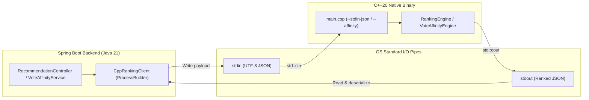

# Issue Pilot

> **Deterministic, explainable open-source issue matching across GitHub, GitLab, Codeberg, and Bugzilla — powered by a Java 21 / Spring Boot orchestration layer, a native C++20 ranking core, adaptive capability diagnostics, and live zero-assignment verification.**

[](https://github.com/xlord101/Issue-Pilot)
[](https://adoptium.net/)
[](https://spring.io/projects/spring-boot)
[](ranking_engine/)
[](https://issuepilot0.vercel.app/app/explore)
[](LICENSE)

Issue Pilot solves the open-source contributor onboarding problem. Labels like `good first issue` are frequently stale, already claimed by an open PR, or wildly mismatched to a developer's actual skill level. Issue Pilot replaces guesswork with a **6-factor deterministic C++ ranking engine**, **live pre-delivery assignment checks**, a **30-second adaptive diagnostic quiz** (eliminating "Quiet GitHub" bias), and **real-time preference learning** from Like/Dislike votes.

---

## Working Features Overview

| Surface / Subsystem | What Actually Runs & Works | Live Location / Implementation |
| :--- | :--- | :--- |
| **Authentication & OTP** | GitHub OAuth sign-in + local Email/Password registration (BCrypt), 6-digit OTP verification, and password reset with automatic sandbox OTP auto-fill when mail delivery is restricted. | `/login`, `/auth/callback` (`AuthController`, `LocalAuthService`) |
| **Dual-Mode Onboarding** | **1) 30s Adaptive Flight Check (CAT)**: 2-question scenario diagnostic across 8 domains with optional Gemini 1.5 Flash synthesis + GitHub cross-verification.<br>**2) 3-Step Calibration Deck & GitHub Scan**: Automatic public repo tech extraction + manual proficiency selection. | `/onboarding` (`AdaptiveDiagnosticController`, `ProfileController`) |
| **Personalized Issue Feed** | Pulls stack-matched issues from MongoDB Atlas (up to 100 candidates), ranks them in native C++, verifies open/unassigned status live before rendering, and applies impression rotation & repo diversity. | `/app/feed`, `/app/recommendations/$id` (`RecommendationController`) |
| **Preference Learning (👍/👎)** | 1-click Like/Dislike with structured dislike reasons (`Not my tech stack`, `Too complex`, `Too simple`, `Unclear description`, `Don't show this repo`). Feeds an independent C++ Laplace-smoothed affinity model. | `/api/votes`, `/api/votes/affinity` (`VoteAffinityService`, `--affinity`) |
| **Multi-Platform Issue Explorer** | Search & filter 3,480+ vetted issues across GitHub, GitLab, Codeberg, and Bugzilla by keyword, stack, platform, and non-overlapping difficulty tiers (`Beginner < 45`, `Intermediate 45–69.9`, `Advanced ≥ 70`). | `/app/explore` (`IssueController`) |
| **Contributor Tech Profile** | Displays calibrated capability dial ($0-100$), confidence score, confirmed skills, and GitHub-inferred skills with one-click recalibration. | `/app/profile` (`ProfileController`) |
| **Automated Ingestion Scheduler** | Background worker discovering new issues, refreshing active candidates, and pruning closed/assigned issues across all 4 platforms. | `SchedulerService`, `DiscoveryService`, `RefreshService` |
| **Backend + C++ Verification** | **225 / 225** Java unit & integration tests passing (`mvn test`) + C++ CTest unit suites (`test_ranking`, `test_affinity`) + multi-stage Docker build. | `Dockerfile`, `pom.xml`, `ranking_engine/CMakeLists.txt` |

---

## Table of Contents

1. [System Architecture & Java ↔ C++ Communication](#1-system-architecture--java--c-communication)
2. [Candidate Pool & Live Zero-Assignment Verification](#2-candidate-pool--live-zero-assignment-verification)
3. [The 6-Factor Authoritative Ranking Model](#3-the-6-factor-authoritative-ranking-model)
4. [Dynamic Preference Learning Engine](#4-dynamic-preference-learning-engine)
5. [30-Second Adaptive Flight Check (CAT Diagnostic)](#5-30-second-adaptive-flight-check-cat-diagnostic)
6. [Multi-Platform Issue Explorer & Difficulty Calibration](#6-multi-platform-issue-explorer--difficulty-calibration)
7. [Resilient Email & Sandbox Auto-Fill Architecture](#7-resilient-email--sandbox-auto-fill-architecture)
8. [MongoDB Atlas Collections & Schemas](#8-mongodb-atlas-collections--schemas)
9. [REST API Reference](#9-rest-api-reference)
10. [Configuration, Build, Test & Docker Deployment](#10-configuration-build-test--docker-deployment)

---

## 1. System Architecture & Java ↔ C++ Communication

Issue Pilot is built across three decoupled layers:
1. **Frontend (TanStack Start + React 19 + Vite v8)**: Deployed on Vercel; handles auth flows, dual-mode onboarding, recommendation cards, explorer search, and tactile voting.
2. **Backend (Java 21 + Spring Boot 3.4.3)**: Deployed via Docker on Render; manages MongoDB Atlas persistence, multi-platform HTTP adapters, rate-limited live verification, JWT auth, and subprocess IPC.
3. **Native Scoring Core (C++20)**: Compiled binary (`issue_pilot_ranking_engine` / `.exe`) invoked by Java via **OS Process Pipes (`stdin` / `stdout` / `stderr`)** using `ProcessBuilder`.

### How Java and C++ Communicate

Rather than using JNI (which couples native memory crashes to the JVM), `CppRankingClient.java` spawns isolated native subprocesses:

1. **Java $\to$ C++ (`stdin`)**: Jackson serializes `{ profile, weights, candidates }` into UTF-8 JSON and writes it to `process.getOutputStream()` with CLI flags (`--stdin-json` or `--affinity`).
2. **C++ Execution**: `main.cpp` reads from `std::cin`, parses JSON into typed C++ structs via `SimpleJsonParser`, computes deterministic scores/affinities in native memory, and serializes output JSON.
3. **C++ $\to$ Java (`stdout`)**: `main.cpp` writes results to `std::cout` and exits `0`. Java captures `process.getInputStream()`, enforces a strict 15-second watchdog timeout, and deserializes results back into Java maps.



---

## 2. Candidate Pool & Live Zero-Assignment Verification

Issue Pilot avoids the two most common failure modes of static issue lists: **ghost issues** (already assigned or linked to an open PR) and **abandoned repositories**.

### Why 3,480+ Issues $\to$ 100 Matched $\to$ Verification Budget of 30?
* **Shared Candidate Pool (`3,480+` issues)**: Continuously populated in MongoDB Atlas across GitHub, GitLab, Codeberg, and Bugzilla.
* **Stack Retrieval (`100` candidates)**: On each feed request, `TechnologyMatchingService` selects up to **100** open issues matching the user's confirmed and inferred technologies. All 100 are scored and sorted by the C++ engine.
* **Live Verification Budget (`VERIFICATION_CANDIDATE_LIMIT = 30`)**: Before delivering issues to the UI, `LiveVerifier` polls the live upstream platform APIs (GitHub/GitLab/Codeberg/Bugzilla) to ensure each top-ranked issue is still strictly open, has zero assignees, and has no linked open PRs (`fixes #N`, `closes #N`). Capping live upstream checks at up to **30** candidates per run guarantees fast feed response times without exhausting API rate limits.
* **Auto-Eviction**: Any candidate discovered to be closed or claimed during live verification is immediately deleted from MongoDB Atlas so no other contributor is served a stale ticket.

---

## 3. The 6-Factor Authoritative Ranking Model

Every candidate score is normalized to $[0, 100]$ deterministically in `ranking_engine/src/ranking_engine.cpp`:

$$\text{FinalScore} = 0.35S + 0.25D + 0.15R + 0.10H + 0.10F + 0.05N$$

| Factor | Name | Default Weight | What It Measures |
| :---: | :--- | :---: | :--- |
| **$S$** | **Skill Match** | **35%** | Overlap between contributor proficiencies and the issue's multi-tech stack (requires $\ge 50\%$ stack coverage gate $A_{\text{cov}}$). |
| **$D$** | **Difficulty Match** | **25%** | Asymmetric proximity between Contributor Capability ($C$) and Objective Difficulty ($D_{\text{obj}}$). Over-difficult issues suffer a **$1.5\times$ burnout penalty** vs. $1.0\times$ for easier ones. |
| **$R$** | **Maintainer Responsiveness** | **15%** | Median first response time, 90-day issue response rate, PR review turnaround, and recent maintainer activity. |
| **$H$** | **Repository Health** | **10%** | 90-day commit velocity, 30-day PR merge rate, active contributor breadth, and maintainer presence. |
| **$F$** | **Feedback / History** | **10%** | Historical acceptance rate, completion rate, and similarity to previously completed tasks. |
| **$N$** | **Freshness** | **5%** | Exponential decay from issue creation date (60-day half-life) and last non-bot activity (14-day half-life). |

### Missing-Data Renormalization
Missing telemetry (e.g., a new user with no feedback history, or rate-limited responsiveness metrics) is **never penalized as 0**. Unavailable components are omitted and remaining weights are scaled proportionally so effective weights always sum to `1.0`.

---

## 4. Dynamic Preference Learning Engine

Contributors can vote directly on any recommended issue:
* **Like (👍)**: Reinforces similar stacks, tags, issue types, and difficulty ranges.
* **Dislike (👎) + Reason Modal**: Captures explicit intent:
  - `Not my tech stack`
  - `Too complex` (nudges capability down)
  - `Too simple` (nudges capability up)
  - `Unclear description`
  - `Don't show this repo` (blacklists repository from future runs)

Votes persist immutable `feature_snapshot` documents in MongoDB (`issue_votes`). On subsequent recommendation runs, `VoteAffinityService` invokes the C++ `--affinity` engine (`ranking_engine/src/vote_affinity.cpp`), which computes 6-group similarity (technologies 30%, labels 30%, issue type 15%, difficulty 10%, domain 10%, repository 5%), damps correlated repeat votes ($\text{sim} \ge 0.85$), and applies **Laplace smoothing ($\lambda = 1.0$)** to shift scores within $[-100, +100]$ with natural-language explanations.

---

## 5. 30-Second Adaptive Flight Check (CAT Diagnostic)

To eliminate **"Quiet GitHub" bias** (skilled developers whose work lives in private or enterprise repos), `/onboarding` offers a 2-step **Computerized Adaptive Testing (CAT)** flow alongside GitHub analysis and the 3-step Behavioral Calibration Deck:

* **8 Supported Domains**: `Python`, `TypeScript`, `React`, `Go`, `Java`, `C++`, `Docker`, `OSS_Workflow`.
* **Adaptive Branching**: Starts at an **Intermediate ($65.0$)** scenario; selecting the optimal architecture/debugging answer steps up to **Advanced ($85.0$)**, while a suboptimal answer steps down to **Beginner ($35.0$)**.
* **Dual-Signal Reconciliation**:
  - **0 Public Repos**: Diagnostic capability is adopted directly, lifting confidence from $0.15$ to **$0.90$**.
  - **Active Public Repos**: Blends diagnostic performance with GitHub history ($0.60 \cdot S_{\text{diag}} + 0.40 \cdot S_{\text{github}}$).
* **Dynamic Gemini 1.5 Flash + Rubric Fallback**: When `GEMINI_API_KEY` is configured, scenarios are dynamically synthesized; if unavailable or rate-limited, `QuizCorpusService` rotates seamlessly through the built-in rubric corpus with zero latency penalty.
* **Automatic Skill Registration**: Completing the flight check automatically confirms the tested technology into the user's profile (`skills`) and marks onboarding complete so `/app/profile` and `/app/feed` work immediately.

---

## 6. Multi-Platform Issue Explorer & Difficulty Calibration

The Explorer (`/app/explore`) queries `/api/issues` across **GitHub**, **GitLab**, **Codeberg**, and **Bugzilla** with non-overlapping difficulty boundaries synchronized between backend MongoDB queries and frontend badges:

* **Beginner**: Technical Complexity $< 45$ (`max_difficulty=44.9`)
* **Intermediate**: Technical Complexity $45 \le x < 70$ (`min_difficulty=45`, `max_difficulty=69.9`)
* **Advanced**: Technical Complexity $\ge 70$ (`min_difficulty=70`)

---

## 7. Resilient Email & Sandbox Auto-Fill Architecture

Local email/password registration (`POST /api/auth/register`) and password resets (`POST /api/auth/forgot-password`) use 6-digit HMAC-hashed OTPs with two delivery paths:

1. **Primary Cloud Transport — Resend HTTP API (Port 443)**: Works reliably on cloud PaaS hosts like Render (which block outbound SMTP ports `25`, `465`, and `587`).
2. **Local SMTP Fallback (`SMTP_HOST`)**: Standard STARTTLS (`587`) support when running locally outside cloud SMTP firewalls.
3. **Automatic Sandbox Auto-Fill (`MAIL_SANDBOX_BYPASS=true`)**:
   - Without a verified custom domain, Resend's test domain (`onboarding@resend.dev`) only delivers to the account owner's email.
   - When an unverified recipient triggers Resend's 403 restriction (or an outbound SMTP timeout occurs), the backend gracefully avoids throwing `502 Bad Gateway`, logs the OTP, and returns `sandbox_otp` in the challenge payload.
   - `frontend/src/routes/login.tsx` detects `sandbox_otp`, notifies the user via toast, and **auto-fills the 6-digit verification input** so any user or evaluator can register and test end-to-end without domain setup.

---

## 8. MongoDB Atlas Collections & Schemas

Spring Boot verifies and maintains **9 MongoDB collections** (with automatic in-memory fallback when MongoDB Atlas is offline):

| Collection | Purpose | Key Indexes |
| :--- | :--- | :--- |
| **`issues`** | Shared multi-platform candidate pool | `(source, repository_full_name, issue_number)` unique; `(state, is_assigned)`; `difficulty_evidence.technical_complexity`; `detected_technologies`; `updated_at` |
| **`users`** | Contributor profiles, capability ($C$), skills | `(user_id)` unique |
| **`issue_votes`** | Like/Dislike votes + immutable `feature_snapshot` | `(user_id, source, platform_issue_id)` unique; `(user_id)`; `(created_at)` |
| **`recommendations`** | Audit snapshots of ranking & verification runs | `(user_id, generated_at)` |
| **`feedback`** | Post-recommendation accept / reject / complete logs | `(user_id, event_timestamp)` |
| **`jobs`** | Ingestion discovery & refresh job history | `(job_id)` unique |
| **`local_credentials`** | Isolated BCrypt password hashes & verification flags | `(email)` unique |
| **`email_otps`** | Hashed 6-digit OTPs with TTL auto-expiration | `(email, purpose)`, TTL on `expires_at` |
| **`user_tokens`** | Encrypted GitHub OAuth tokens & exchange state | `(user_id)` unique |

---

## 9. REST API Reference

| Group | Endpoints |
| :--- | :--- |
| **Health** | `GET /api/health` (DB status, C++ engine availability & version) |
| **Auth** | `GET /api/auth/github/login`, `GET /api/auth/github/callback`, `POST /api/auth/exchange`, `POST /api/auth/register`, `POST /api/auth/verify-otp`, `POST /api/auth/resend-otp`, `POST /api/auth/login`, `POST /api/auth/forgot-password`, `POST /api/auth/reset-password`, `GET /api/auth/me`, `POST /api/auth/logout` |
| **Profile & Onboarding** | `GET /api/profile/me`, `GET /api/profile/onboarding`, `POST /api/profile/onboarding/confirm`, `POST /api/profile/analyze`, `PUT /api/profile/skills/{tech}`, `DELETE /api/profile/skills/{tech}`, `PUT /api/profile/preferences` |
| **Adaptive Diagnostic** | `GET /api/onboarding/diagnostic/domains`, `POST /api/onboarding/diagnostic/start`, `POST /api/onboarding/diagnostic/step` |
| **Recommendations** | `POST /api/recommendations/personalized`, `GET /api/recommendations/{id}`, `GET /api/recommendations/snapshots/{userId}`, `GET /api/recommendations/runs/{runId}` |
| **Issues Explorer** | `GET /api/issues`, `GET /api/issues/{issueId}`, `POST /api/issues/batch-upsert` |
| **Votes & Affinity** | `POST /api/votes`, `DELETE /api/votes`, `GET /api/votes/{userId}`, `GET /api/votes/summary/{userId}`, `POST /api/votes/affinity` |
| **Ingestion & Jobs** | `POST /api/ingestion/run`, `POST /api/ingestion/discover`, `POST /api/ingestion/refresh`, `POST /api/ingestion/cleanup`, `GET /api/ingestion/status`, `GET /api/ingestion/jobs` |
| **Validation & Backend Eval** | `POST /api/validation/run`, `GET /api/validation/evaluation-report`, `POST /api/simulator/rank`, `GET /api/simulator/sample-data` |

---

## 10. Configuration, Build, Test & Docker Deployment

### Environment Variables (`.env` / Render Dashboard)

| Variable | Default / Example | Purpose |
| :--- | :--- | :--- |
| `PORT` / `SERVER_PORT` | `8000` | HTTP port for Spring Boot |
| `CPP_ENGINE_PATH` | `ranking_engine/build/issue_pilot_ranking_engine.exe` | Path to compiled C++ binary (set to Linux path in Docker) |
| `MONGODB_URI` | `mongodb+srv://...` | MongoDB Atlas connection string |
| `APP_JWT_SECRET` | *(32+ byte secret)* | HMAC key for signing session JWTs and hashing OTPs |
| `GITHUB_CLIENT_ID` / `SECRET` | `""` | GitHub OAuth app credentials |
| `GITHUB_TOKEN` | `""` | GitHub PAT for ingestion & live PR/assignee checks |
| `GITLAB_TOKEN` | `""` | GitLab PAT for GitLab v4 ingestion |
| `GEMINI_API_KEY` | `""` | Optional key for live Gemini 1.5 Flash flight check scenarios |
| `RESEND_API_KEY` | `re_...` | Resend HTTP API key for transactional OTPs (Port 443) |
| `MAIL_FROM` | `Issue Pilot <onboarding@resend.dev>` | Sender address for OTP emails |
| `MAIL_SANDBOX_BYPASS` | `true` | Auto-surfaces sandbox OTPs in UI instead of failing with 502 |
| `SMTP_HOST` / `PORT` / `USER` / `PASS` | `""` | Optional SMTP for local use only *(leave blank on Render)* |

### 1. Build & Test the C++ Engine
```bash
cmake -B ranking_engine/build -S ranking_engine
cmake --build ranking_engine/build
ctest --test-dir ranking_engine/build --output-on-failure
```

### 2. Test & Run the Spring Boot Backend (Java 21)
```bash
# Run all 225 backend unit & integration tests
mvn test

# Start the API server on http://localhost:8000
mvn spring-boot:run
```

### 3. Build & Run the Frontend
```bash
cd frontend
npm install
npm run dev      # Local dev server at http://localhost:5173
npm run build    # Production Vite + Nitro build
```

### 4. Backend Operator CLI Commands
```bash
mvn spring-boot:run -Dspring-boot.run.arguments="--eval"       # NDCG@5, Precision@5, Recall@5
mvn spring-boot:run -Dspring-boot.run.arguments="--benchmark"  # C++ IPC latency & throughput
mvn spring-boot:run -Dspring-boot.run.arguments="--audit"      # MongoDB Atlas schema & count audit
mvn spring-boot:run -Dspring-boot.run.arguments="--discover"   # Multi-platform discovery run
```

### 5. Production Docker Image (Backend + C++ Engine)
The multi-stage [`Dockerfile`](Dockerfile) compiles the C++20 binary (`ubuntu:24.04`), runs CTest, builds the Spring Boot JAR (`maven:3.9.9-eclipse-temurin-21`), and packages a minimal `eclipse-temurin:21-jre-noble` runtime container exposing port `8000`.

---

## License

Issue Pilot is licensed under the [Apache License, Version 2.0](LICENSE).
